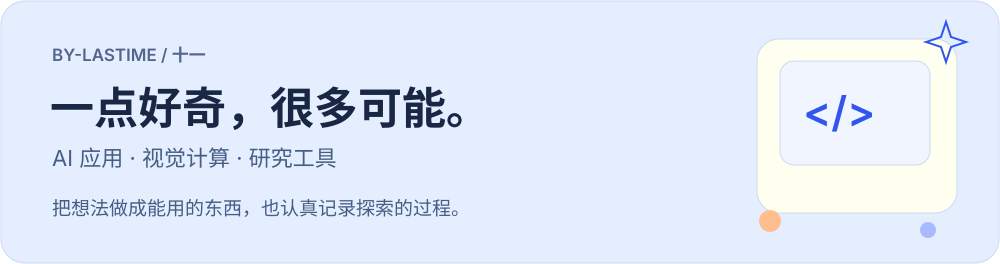
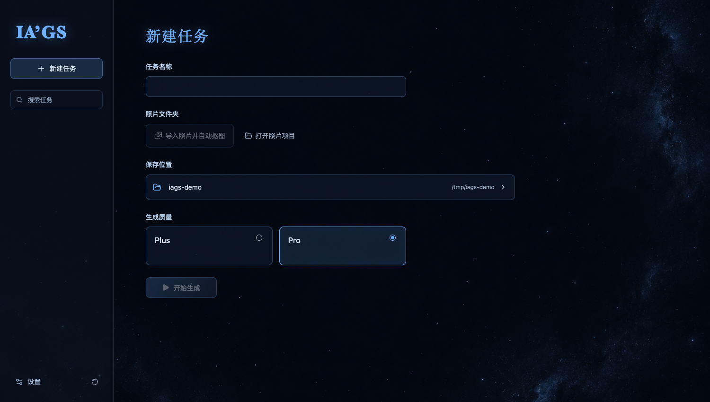
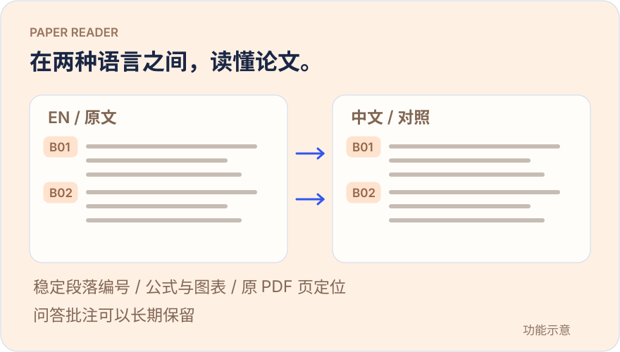
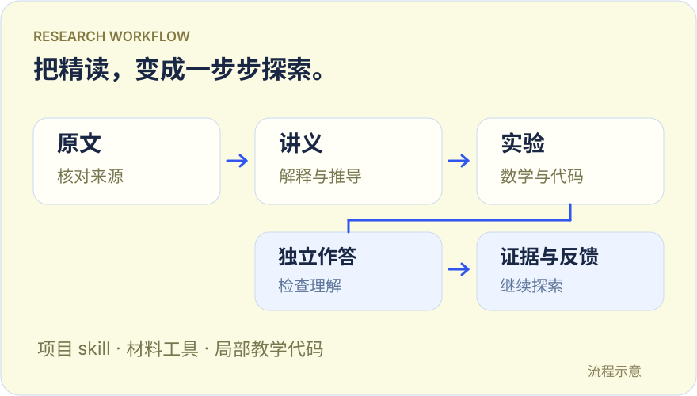
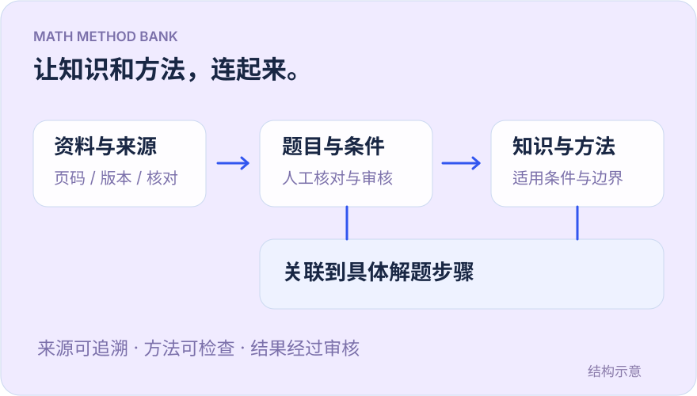

  

我关注 **AI 应用、计算机视觉与研究工具**，喜欢从实际问题出发，把想法做成可以使用、检查和继续改进的项目。

**[逛逛我的个人空间 ↗](https://lastime-little-space.fun-root-1056.chatgpt.site)** · [浏览全部仓库](https://github.com/by-lastime?tab=repositories) · [正在探索](#正在探索)

## 一些小项目

<table>
  <tr>
    <td width="50%" valign="top">
      
      <h3>01 · IA’GS</h3>
      
<strong>把照片，变成立体。</strong>

      
面向 Apple Silicon Mac 的本地照片转 3D 高斯工具，支持遮罩修正、相机分组、模型预览与导出。

      
<code>macOS 测试版</code> <code>Rust / Tauri</code>

      
<a href="https://github.com/by-lastime/IA-GS">查看代码 →</a> · <a href="https://github.com/by-lastime/IA-GS/releases/tag/v0.1.0">下载应用</a>

      基于 OOOSplat 的开源衍生项目，保留上游与第三方声明。
    </td>
    <td width="50%" valign="top">
      
      <h3>02 · 论文双语阅读器</h3>
      
<strong>在两种语言之间，读懂论文。</strong>

      
通过稳定段落编号连接中英文，提供公式与图表、原 PDF 页定位，以及可以长期保留的问答批注。

      
<code>本地工具 / MIT</code> <code>JavaScript</code>

      
<a href="https://github.com/by-lastime/bilingual-paper-reader">查看代码 →</a> · <a href="https://github.com/by-lastime/bilingual-paper-reader-showcase">项目介绍</a>

      需自行接入阅读材料；预览图为功能示意。
    </td>
  </tr>
  <tr>
    <td width="50%" valign="top">
      
      <h3>03 · 研究学习工作流</h3>
      
<strong>把精读，变成一步步探索。</strong>

      
从论文原文出发，组织主题讲义、数学与代码、独立作答和反馈；公开项目 skill、材料工具与教学代码。

      
<code>开源工作流 / MIT</code> <code>Python</code>

      
<a href="https://github.com/by-lastime/research-learning-workflow">查看代码 →</a> · <a href="https://github.com/by-lastime/research-learning-workflow-showcase">项目介绍</a>

      已有实验记录对应局部教学验证；预览图为流程示意。
    </td>
    <td width="50%" valign="top">
      
      <h3>04 · 数学知识与方法题库</h3>
      
<strong>让知识和方法，连起来。</strong>

      
关联题目、来源、知识点与解题步骤，探索资料追溯、人工核对、方法适用条件与专题浏览。

      
<code>项目展示</code> <code>Python / React</code>

      
<a href="https://github.com/by-lastime/math-bank-showcase">了解项目 →</a> · <a href="https://github.com/by-lastime/math-bank-showcase/blob/main/docs/method-example.md">方法示例</a>

      源码与完整数据私有；预览图为结构示意。
    </td>
  </tr>
</table>

## 按方向逛逛

| 方向 | 项目 | 用途与当前状态 |
| :--- | :--- | :--- |
| **视觉计算** | [IA’GS](https://github.com/by-lastime/IA-GS) | 本地照片转 3D 高斯模型 · macOS 早期测试版 |
| **研究与阅读** | [论文双语阅读器](https://github.com/by-lastime/bilingual-paper-reader) | 段落对照、来源定位、持久化批注 · MIT 开源 |
| | [研究学习工作流](https://github.com/by-lastime/research-learning-workflow) | 论文精读、教学实验与来源核验 · MIT 开源 |
| **学习与知识** | [数学知识与方法题库](https://github.com/by-lastime/math-bank-showcase) | 资料追溯、方法关联与审核 · 公开项目介绍 |
| | [阳阳不忘词](https://github.com/by-lastime/yangyang-vocabulary-showcase) | 小组词汇打卡、美音与复习 · 上线准备中，源码私有 |
| **协作工具** | [Codex 中文写作 Skills](https://github.com/by-lastime/codex-deepseek-skills) | 中文写作与多轮评审协作流程 · 需本地环境 |

## 正在探索

**猫类意图识别 · 多模态感知**  
负责课题定义、技术路线、数据与标签方案，探索音频特征、姿态识别与晚期融合。已获学院“创新+”工作站立项，进入数据整理与 baseline 实验阶段。

**太阳暗条实例分割 · 2026 挑战赛方案**  
面向 H-alpha 图像，重点研究高分辨率 Mask R-CNN，并以 U-Net 作对照；关注时间分组划分、细小目标召回、PQ 与分组 Bootstrap 验证。

**跨语言提示与中国形象表征 · 研究进行中**  
研究不同语言提示下的视觉表征差异与传播偏差，结合多模态主题编码、人工核验、计算美学与统计比较。

  
<strong>课程与团队项目：麻将 AI / 校园 Agent</strong>

  
<strong>Botzone 国标麻将 AI</strong> · 参与策略训练与评测设计，结合 MultiTask ResCNN、合法动作重排和本地 arena，比较训练策略并分析评测环境差异。

  
<strong>PKU-Captain 校园 Agent</strong> · 三人团队项目，参与 PyQt6 GUI 与系统集成，连接校园信息、工具、记忆与文档检索，形成可运行桌面原型。

## 常用技术与工具

| 用在什么地方 | 技术与工具 |
| :--- | :--- |
| 模型与数据 | `Python` · `PyTorch` · `计算机视觉` · `多模态分析` |
| 产品与界面 | `JavaScript / TypeScript` · `React` · `PyQt6` · `Rust / Tauri` |
| 服务与协作 | `FastAPI` · `Node.js` · `SQL` · `Git / GitHub` |

  
<strong>课程复习笔记 · 持续更新</strong>

  
<a href="https://github.com/by-lastime/ics-study-notes">ICS · 计算机系统</a> · <a href="https://by-lastime.github.io/ics-study-notes/">在线阅读</a>

  
<a href="https://github.com/by-lastime/vci-study-notes">VCI · 可视计算与交互</a> · <a href="https://by-lastime.github.io/vci-study-notes/">在线阅读</a>

  
两份笔记均提供目录、使用说明、在线与离线 HTML 以及 PDF。课程尚未结束。

---

<strong>一点好奇，很多可能。</strong> <a href="https://lastime-little-space.fun-root-1056.chatgpt.site">来我的个人空间逛逛 ↗</a>

